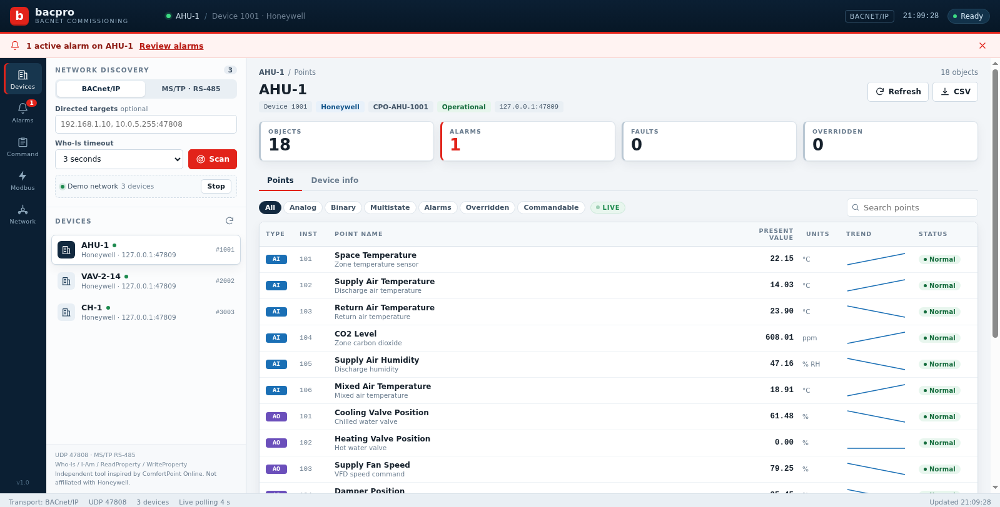
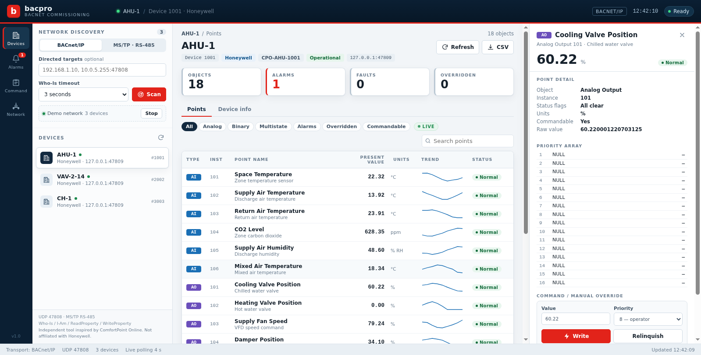

# bacpro

**A lightweight BACnet commissioning console for your laptop — discover devices, browse points, and write values over BACnet/IP or RS-485 MS/TP — with a full Modbus TCP/RTU master and slave simulator built in.**

bacpro is a single-file desktop application. It speaks BACnet natively: the whole protocol
stack (BVLC, NPDU, APDU, ASHRAE 135 tag encoding, and the MS/TP data link layer) is written
in pure Python with **no external BACnet library**, the Modbus master and simulator are
equally self-contained, and the front end is dependency-free vanilla JavaScript. No runtime,
no database, no installer bloat — one executable.



> **Disclaimer:** bacpro is an independent tool *inspired by* the ComfortPoint Online
> interface. It is not affiliated with, endorsed by, or produced by Honeywell.
> "Honeywell" and "ComfortPoint" are trademarks of their respective owners.

---

## Contents

1. [Install and run](#1-install-and-run)
2. [Building the executable](#2-building-the-executable)
3. [Connecting to a building](#3-connecting-to-a-building)
4. [Writing values and manual override](#4-writing-values-and-manual-override)
5. [MS/TP over RS-485](#5-mstp-over-rs-485)
6. [Modbus master](#6-modbus-master)
7. [BBMD and foreign device](#7-bbmd-and-foreign-device)
8. [The interface](#8-the-interface)
9. [Safety](#9-safety)
10. [Architecture](#10-architecture)
11. [Troubleshooting](#11-troubleshooting)

---

## 1. Install and run

### Prebuilt executable (recommended)

| Platform | File | How to run |
|---|---|---|
| Windows 10/11 | `bacpro.exe` | Double-click. A chromeless app window opens. |
| Linux | `bacpro` | `./bacpro` (make it executable with `chmod +x bacpro`) |

The first launch unpacks the bundled web UI into a temp folder and starts a private
web service on `127.0.0.1:5001`. Your firewall does not need to allow anything inbound —
the console is only reachable from your own machine. The window is drawn by the Edge or
Chrome browser that every Windows 10/11 machine already has; nothing is installed and no
Python is required.

**It behaves like a normal desktop app.** Close the window and bacpro exits — no orphaned
background process, no port left open. Launch it again and it comes straight back. If
something goes wrong there is no console to read, so everything is written to a log:

| Platform | Log file |
|---|---|
| Windows | `%LOCALAPPDATA%\bacpro\logs\bacpro.log` |
| Linux | `~/.local/share/bacpro/logs/bacpro.log` |
| macOS | `~/Library/Application Support/bacpro/logs/bacpro.log` |

The log rotates at 2 MB (three older copies kept), and a fatal startup error is also shown
in a message box pointing at that file.

**Windows SmartScreen:** because the executable is not code-signed, Windows may show
*"Windows protected your PC"*. Click **More info → Run anyway**. This is expected for an
unsigned in-house tool. If your IT policy blocks it, build from source (section 2) or ask
your administrator to sign the binary.

### From source

```bash
python -m venv .venv
.venv\Scripts\activate        # Windows
source .venv/bin/activate     # Linux / macOS
pip install -r requirements.txt

python run.py                 # desktop window
python server.py              # console only, then open http://127.0.0.1:5001
```

`run.py` switches:

| Flag | Effect |
|---|---|
| `--port 5002` | Use a different local port (handy when 5001 is taken) |
| `--no-browser` | Serve only, don't open a window |
| `--headless` | Same as `--no-browser`, for running on a server |
| `--keep-alive` | Keep serving after the window is closed (Ctrl+C to stop) |
| `--idle-timeout 180` | Seconds without a live page before exiting, when the window process cannot be tracked |
| `--verbose` | Debug-level logging |

bacpro is single-instance: launching it a second time just re-opens the window on the
already-running service.

---

## 2. Building the executable

> **No Python on your laptop?** You don't need any. Push the repo to GitHub and the
> included workflow builds `bacpro.exe` on a free Windows runner — see **[BUILD.md](BUILD.md)**
> for that and the other build routes.

### Windows

Double-click **`build_windows.bat`**. It creates `.venv`, installs dependencies, generates
the icon, and runs PyInstaller. The result is `dist\bacpro.exe` — a single ~17 MB file you
can copy to any Windows machine (no Python needed).

There is also an **Inno Setup script** at `installer\bacpro.iss` for a proper installer
with Start Menu and desktop shortcuts and an uninstaller. Build it on Windows with Inno
Setup 6 installed (`iscc installer\bacpro.iss`), or let the GitHub workflow do both: it
publishes `bacpro.exe` (portable) and `bacpro-setup.exe` (installer).

### Linux / macOS

```bash
./build_linux.sh
# result: dist/bacpro
```

Both scripts drive the same `bacpro.spec`, which bundles `static/` and `assets/` into the
executable and excludes heavy libraries (numpy, pandas, matplotlib, tkinter) to keep the
binary small. The icon is generated by `tools/make_icon.py` from pure Pillow drawing code,
so there are no binary assets to manage in source control.

**Antivirus false positives:** PyInstaller one-file executables are occasionally flagged
by heuristic scanners. Building with `--onedir` (remove `onefile` behaviour in the spec) or
signing the binary resolves this.

---

## 3. Connecting to a building

### BACnet/IP

1. Plug your laptop into the building network (or the BBMD-enabled subnet).
2. Select the **BACnet/IP** tab in the discovery panel.
3. Leave **Directed targets** blank for a normal broadcast Who-Is, or enter specific
   addresses for routed networks:
   - `192.168.1.10` — a single device
   - `192.168.1.255` — a subnet broadcast
   - `10.0.5.20:47808` — a specific address and port
   - Multiple entries separated by commas or spaces.
4. Pick a **Who-Is timeout** (2 s is fine on a flat LAN; 5–8 s for large or routed
   networks) and press **Scan**.

Every device that answers I-Am appears in the station list with its instance number,
vendor, and IP address. Click one to browse it.

> **UDP port:** bacpro binds to UDP **47808** (the standard BACnet port) for its client
> socket. If another BACnet tool is already running on your laptop, close it first, or
> expect discovery to be one-sided.

### Directed discovery

Broadcast Who-Is does not cross IP routers. On a routed job you must either:

* point bacpro at the **BBMD** (BACnet Broadcast Management Device) address, or
* list the target device IPs explicitly in **Directed targets**.

bacpro sends a unicast Who-Is to each target, so devices behind a router will answer
directly.

---

## 4. Writing values and manual override

Click any point row to open the detail drawer. Commandable objects (analog/binary/multistate
outputs and values — AO, AV, BO, BV, MSO, MSV) show a **Command / Manual override** panel
at the bottom of the drawer.



### The priority array

BACnet resolves a commandable point's Present Value by scanning the 16-slot priority array
from **priority 1 (highest)** to **16 (lowest)** and taking the first non-NULL slot. If all
16 slots are NULL, the point falls back to its Relinquish Default. bacpro shows the whole
array in the drawer, with the active slot highlighted.

| Priority | Typical use |
|---|---|
| 1–2 | Life safety / fire override |
| 3 | Critical interlock |
| 4–7 | Energy / demand limiting |
| **8** | **Operator manual command (bacpro default)** |
| 9–15 | Sequences, schedules, optimisers |
| 16 | Lowest-priority fallback |

### Writing a value

1. Open the point.
2. Enter the new value (a number for analog, On/Off for binary, a state name for multistate).
3. Choose a **priority** — 8 is the operator default and is what a BAS front-end normally
   uses for a manual command.
4. Press **Write**.

bacpro sends a BACnet **WriteProperty** for `present-value` at the chosen priority. The
device stores your value in that priority slot and the point immediately reads back as
**Overridden** in the points table. The write is recorded in the **Command** log with
timestamp, point, value, priority, and result.

### Releasing a command

* **Relinquish** (in the drawer) writes BACnet **NULL** to that priority slot, returning
  control to whatever is next in the array — usually the sequence or schedule.
* To release everything, relinquish each slot you own. A point is only back to
  **Normal** once no slot above the relinquish-default holds a value.

### What you can and cannot write

| Object type | Writable in bacpro |
|---|---|
| AO, AV, BO, BV, MSO, MSV | Yes — commandable |
| AI, BI, MSI | No — inputs are read-only; the device returns *write access denied* |
| Device object | Read-only properties only |

bacpro surfaces the device's own error text (`write access denied`, `value out of range`,
`invalid priority`, `unknown property`) rather than a generic failure, so you know whether
the problem is permissions, range, or addressing.

---

## 5. MS/TP over RS-485

BACnet MS/TP is the two-wire RS-485 field bus used by VAVs, fan coils, and unitary
controllers. bacpro implements the full MS/TP master node: token passing, Poll-For-Master,
frame CRC, and the master state machine — so a USB-to-RS-485 converter on your laptop
becomes a BACnet MS/TP station.

### Hardware

You need a **USB to RS-485 converter** (FTDI, CH340, CP2102, or similar) that appears as a
COM port. Two-wire, half-duplex. Most industrial converters handle the direction control
automatically; if yours has a separate RTS toggle, it must be set to auto.

### Wiring

```
   bacpro laptop                         MS/TP trunk
   ┌──────────────┐                    ┌───────────────┐
   │ USB → RS-485 │  A (+) ────────────┤  A  device 1  ├──── A  device 2 ...
   │  converter   │  B (−) ────────────┤  B            │
   │              │  GND  ─────────────┤  GND / REF    │
   └──────────────┘                    └───────────────┘
```

* **A** to **A**, **B** to **B**. If you get no replies, swap A and B — manufacturers are
  inconsistent about which line is "+".
* Connect **signal ground / reference** between the converter and the trunk. RS-485 tolerates
  a common-mode offset, but not an unbounded one.
* **120 Ω termination at both physical ends of the trunk.** Not at every device — just the
  two ends. bacpro's converter is normally one end.
* **Bias resistors** (typically 560 Ω pull-up on A, pull-down on B) somewhere on the segment,
  usually at the master. Many USB converters include switchable bias and termination —
  enable them only if the segment needs it.
* Keep the trunk as a **daisy chain**, not a star. Stubs should be short (< 1 m).

### Settings in bacpro

| Setting | Recommended | Notes |
|---|---|---|
| **COM port** | your converter | The dropdown lists every serial port the OS reports |
| **Baud** | **38400** | Must match the trunk exactly. 9600 and 76800 also common |
| **MAC address** | **1** | Your station address. Must be unique on the segment. Avoid 0 (often the router/BBMD) and 255 (broadcast) |
| **Max Master** | **127** | Highest MAC in use on the segment. Lower it (e.g. 32) to speed up token rotation on small trunks |

Press **Connect**. The status line shows the token state and frame counters. Then run a
**Scan** exactly as with IP — Who-Is goes out over MS/TP and every controller answers.

The **Network** view shows live MS/TP link statistics: tokens received, frames sent and
received, CRC errors, timeouts, and Poll-For-Master count. **CRC errors climbing** almost
always means wiring, termination, or a baud mismatch.

### Troubleshooting MS/TP

| Symptom | Likely cause |
|---|---|
| Connects but no devices answer | A/B swapped, baud mismatch, or wrong Max Master |
| CRC errors climbing | Missing/extra termination, star wiring, no ground reference |
| Tokens but no data | MAC conflict with another master on the segment |
| `could not open port` | Another program (or a previous bacpro session) holds the COM port |
| Works on short bench cable, fails on site | Bias/termination missing, or cable too long for the baud rate |

---

## 6. Modbus master

The **Modbus** rail button opens a Radzio-style master that talks to PLCs, VFDs, meters,
valve actuators and anything else speaking Modbus TCP or Modbus RTU over RS-485.

### Connect

Pick **Modbus TCP** (host + port, default 502) or **RTU · RS-485** (COM port, baud,
parity). The unit ID and timeout live in the same bar. *Connect* opens the link and keeps
it open; every subsequent read and write reuses it, exactly like a bench master. RTU uses
the same USB→RS-485 converter as the MS/TP section — A→A, B→B, GND→GND, 120 Ω at
both ends.

### What is online

**Unit scan** walks a range of unit IDs (1–247) and asks each one for a single register
or coil. A slave that answers — even with an exception such as *illegal data address* —
is online; silence means nothing is at that address. TCP scans run in parallel with one
short-lived connection per worker, so a scan of 247 units finishes in seconds without
upsetting a gateway. Results list the unit ID, the round-trip time, and whether the answer
was data or an exception.

### Registers

The viewer reads 1–125 registers or coils at a time from any of the four tables:

| Table | Function | Address range |
|---|---|---|
| Holding registers | 03 | 0–65535 (40001– in Modicon notation) |
| Input registers | 04 | 0–65535 (30001–) |
| Coils | 01 | 0–65535 (00001–) |
| Discrete inputs | 02 | 0–65535 (10001–) |

Each row shows the address, the raw register word(s), hex, and a decoded value. **Format**
changes the decoding without another read: unsigned/signed 16-bit, unsigned/signed 32-bit,
32-bit float, hex, binary, ASCII, and both word orders for 32-bit values. 32-bit formats
consume two registers and the second row is marked as a continuation, so a float spread
across 40001/40002 reads as one number.

### Writing

Write a single register (06), a block of registers (16), a single coil (05), or a block of
coils (15). Values are entered in the same format as the viewer, so typing `21.5` with
*float* selected writes the correct two words. Every write is echoed in the **Command** log
with the target, address, value and result, and Modbus exceptions are surfaced in plain
English (*illegal data value*, *server device failure*, and so on) rather than as a timeout.

### Built-in slave simulator

The **Built-in slave simulator** card starts a real Modbus TCP server on your machine
(default port 5020) serving unit IDs 1, 2, 3. Holding registers 0–19 hold `100 + 7n`,
input registers 0–9 hold `500 + 3n`, coils alternate on/off, a float `21.5` sits at address
100, and a 32-bit counter `123456` at 110. Point the master at `127.0.0.1:5020` and every
screen can be exercised — reads, formats, writes, scans — with no hardware and no risk.
Unknown unit IDs deliberately stay silent, which is what makes the scan meaningful.

---

## 7. BBMD and foreign device

BACnet/IP broadcasts (Who-Is, I-Am, COV notifications) do not cross IP routers. A **BBMD**
(BACnet Broadcast Management Device) on each subnet fixes that: it forwards broadcasts
between subnets. bacpro can register itself with a BBMD as a **foreign device**, which is
how you commission a building from a laptop plugged into a different subnet — or over a
VPN — without touching the routers.

Open **Network** and use the **BBMD / foreign device** card:

* **BBMD address** — `10.0.0.5` or `10.0.0.5:47808`.
* **TTL** — how long the registration lasts (default 300 s). bacpro renews it
  automatically at roughly two-thirds of the TTL, so a long commissioning session keeps
  working; if the link drops, the registration expires on its own and the BBMD forgets you.
* **Register / Unregister** — sends *Register-Foreign-Device* (BVLC 0x05) and reports the
  BBMD's result code, or *Delete-Foreign-Device-Table-Entry* when you unregister.
* **Read BDT** — the BBMD's Broadcast Distribution Table: the peer BBMDs it forwards to.
* **Read FDT** — the Foreign Device Table: every foreign device currently registered with
  it, with TTL and time remaining. Your own entry appears here, which is a useful proof that
  the registration is live.

Once registered, Who-Is is sent as *Distribute-Broadcast-To-Network* (BVLC 0x09) and the
replies come back wrapped in *Forwarded-NPDU* (BVLC 0x04), so devices on the far side of
the router show up in the station tree like local ones. Everything else — ReadProperty,
WriteProperty, priority arrays — is unicast and works unchanged.

The **demo network** acts as a BBMD too: register against `127.0.0.1:47809` and you can
watch the BDT/FDT fill in and a Who-Is travel the whole foreign-device path on one machine.

---

## 8. The interface

bacpro follows the ComfortPoint Online layout:

* **Left icon rail** — Devices, Alarms, Command (audit log), Modbus, Network.
* **Station tree** — every discovered device, grouped by transport, with instance numbers.
* **Alarm banner** — a red strip across the top when any point is in alarm, with a jump link.
* **Points table** — object badge, instance, name, description, present value, units,
  sparkline trend, and status. Filter chips for All / Analog / Binary / Multistate /
  Alarms / Overridden / Commandable, plus free-text search.
* **Device header** — object count, alarms, faults, and overridden count as stat tiles.
* **Point drawer** — full point detail, priority array, and command panel.
* **Status bar** — transport, port, device count, poll state, last update time.
* **Modbus view** — connection bar, unit scan, register viewer/writer, slave simulator.
* **Network view** — transport and MS/TP statistics, plus the BBMD / foreign-device card.

Values are polled every 4 seconds and patched into the table in place, so the screen stays
live without flicker. **CSV** exports the currently filtered table.

---

## 9. Safety

**Read this before pointing bacpro at a live building.**

Writing to a BACnet point changes real equipment. A command to a supply fan, valve, or
damper affects the physical plant and the people in the building.

* **Use priority 8 for manual commands.** Higher priorities (1–3) are usually reserved for
  life-safety and critical interlocks; writing there can override protective logic.
* **Always relinquish when you are done.** A forgotten override at priority 8 will hold a
  valve or fan at your value indefinitely, regardless of schedule.
* **Check the point before you write it.** Writing a setpoint to a valve position, or a
  binary command to an analog point, produces unpredictable behaviour.
* **Coordinate with the site.** Tell the building operator you are commissioning. A fan
  stopping unexpectedly is an incident.
* **Test on the demo network first.** The built-in simulator (see below) lets you exercise
  every feature with zero risk.

The **Command** log records every write with a timestamp, so there is an audit trail of
what you changed and when.

### Demo network

Press **Demo network** in the discovery panel to start a built-in virtual BACnet/IP device
set (AHU-1, VAV-2-14, CH-1 on UDP 47809). It behaves like real hardware: 16-slot priority
arrays, status flags, alarm states, and write rejection on input objects. This is the
fastest way to learn the tool, and it is what the automated tests run against.

---

## 10. Architecture

```
run.py                  Desktop launcher: local server + app window, single instance
server.py               Flask API + static hosting
bacpro.spec             PyInstaller build definition
build_windows.bat       One-click Windows build
build_linux.sh          One-click Linux build

bacnet/
  constants.py          Object types, property IDs, service codes
  encoding.py           ASHRAE 135 tag encode/decode (app + context tags, NULL)
  client.py             BACnet/IP client: Who-Is, ReadProperty, WriteProperty, BBMD
  simulator.py          Virtual BACnet/IP device with priority arrays + BBMD behaviour
  mstp.py               MS/TP: CRC-16/X.25, frame codec, master state machine, transport
  mstp_sim.py           Loopback MS/TP slave for hardware-free testing

modbus/
  codec.py              RTU CRC-16, MBAP framing, PDU builders/parsers, register formats
  master.py             TCP + RTU transports, read/write, unit-ID scan
  slave.py              Slave core + TCP/RTU servers used by the simulator and tests
  api.py                Flask routes for the Modbus section

static/
  index.html            Console shell
  styles.css            ComfortPoint-inspired theme
  app.js                Vanilla-JS front end (no framework)

tools/make_icon.py      Generates assets/icon.png + icon.ico
installer/bacpro.iss    Inno Setup script (optional Windows installer)
test_protocol.py        15 assertions: IP discover/read/write/relinquish
test_mstp.py            23 assertions: MS/TP frame codec + loopback discover/read/write
test_bbmd.py            13 assertions: foreign-device registration, BDT/FDT, large device
test_modbus.py          51 assertions: codec, CRC, TCP/RTU master-slave, live pymodbus server
test_modbus_api.py      33 assertions: Modbus HTTP API end to end
```

Every API route is transport-agnostic. The server resolves a device reference to either an
`(ip, port)` tuple or an MS/TP MAC, then calls the same `read_property` / `write_property`
interface on either client. Adding a transport means implementing one client class, not
touching the UI.

### Tests

```bash
python test_protocol.py     # 15 passed, 0 failed
python test_mstp.py         # 23 passed, 0 failed
python test_bbmd.py         # 13 passed, 0 failed
python test_modbus.py       # 51 passed, 0 failed
python test_modbus_api.py   # 33 passed, 0 failed
```

135 checks in total. The MS/TP test runs against an in-process loopback slave, so it needs
no serial hardware: real frame encoding, CRC validation, token passing, Who-Is,
ReadProperty, WriteProperty, priority-array readback, and relinquish.

The protocol encoders are checked against independent implementations rather than against
themselves — `bacpypes3` for BVLC headers, ASHRAE 135 tag encoding and WriteProperty
payloads, the reference `bacnet-stack` CRC routines for MS/TP, and `pymodbus` for every
Modbus PDU, the RTU CRC, and a live Modbus TCP server that the master reads and writes
through. If a test passes, an independent stack agrees with our bytes.

### API reference

| Method | Route | Purpose |
|---|---|---|
| GET | `/api/status` | Transport, simulator, MS/TP link state |
| GET | `/api/discover` | Who-Is scan (`transport`, `timeout`, `targets`) |
| GET | `/api/device` | Full object inventory for one device |
| GET | `/api/read` | Read one property |
| GET | `/api/priority` | Read a point's 16-slot priority array |
| POST | `/api/write` | WriteProperty with priority / relinquish |
| GET | `/api/audit` | Command log |
| GET | `/api/mstp/ports` | Enumerate serial ports |
| POST | `/api/mstp/connect` | Open the RS-485 link |
| POST | `/api/mstp/disconnect` | Close the link |
| GET | `/api/mstp/status` | MS/TP statistics |
| POST | `/api/simulator/start` \| `/stop` | Demo network control |
| GET | `/api/bbmd/status` | Foreign-device state + simulator BDT/FDT |
| POST | `/api/bbmd/register` \| `/unregister` | Register as a foreign device |
| GET | `/api/bbmd/bdt` \| `/fdt` | Read a BBMD's tables |
| POST | `/api/bbmd/delete` | Delete one foreign-device entry |
| GET | `/api/modbus/ports` | Enumerate serial ports |
| POST | `/api/modbus/connect` \| `/disconnect` | Open / close a Modbus link |
| GET | `/api/modbus/status` | Connection + simulator state |
| POST | `/api/modbus/scan` | Scan a range of unit IDs |
| POST | `/api/modbus/read` | Read registers or coils |
| POST | `/api/modbus/write` | Write registers or coils |
| POST | `/api/modbus/sim/start` \| `/stop` \| `/status` \| `/registers` | Built-in slave simulator |

---

## 11. Troubleshooting

**Nothing found on BACnet/IP**
Check you are on the right VLAN and that UDP 47808 is not blocked. Try a directed target
(the device's IP) instead of broadcast. Confirm the device's BACnet/IP is enabled and its
Device Instance is non-zero.

**"Address in use" on launch**
Another program holds UDP 47808 or TCP 5001. Close other BACnet tools, or start bacpro with
`--port 5002`.

**Values don't update**
Live polling is on by default; check the **LIVE** pill in the points toolbar. If a device is
slow, increase the Who-Is timeout and re-scan — some controllers drop reads while busy.

**Write returns "write access denied"**
The point is an input (AI/BI/MSI), the device is in a locked/handoff state, or your BACnet
client is not in the device's write list. Check the object type first.

**Write succeeds but the value doesn't change**
Something at a higher priority is holding the point. Open the drawer and look at the
priority array — a slot numbered lower than yours is winning.

**MS/TP: connects, then immediately drops**
Usually a MAC conflict or a baud mismatch. Confirm no other master uses your MAC, and that
the trunk baud matches the setting exactly.

**The window opens blank**
The local service may still be starting. Wait a second and refresh. If it persists, run
`bacpro --no-browser` from a terminal and open `http://127.0.0.1:5001` manually to see the
error, or read the log file listed in section 1.

**The app closes as soon as it opens**
On a machine with no Edge or Chrome, bacpro falls back to the default browser and then
relies on a page heartbeat; if the browser never loads the page it exits after
`--idle-timeout` seconds. Run with `--keep-alive` to pin it open.

**Modbus: every unit looks offline**
Wrong unit ID, wrong parity/baud on RTU, or a gateway that needs a small delay between
requests. Try a single read first (holding register 0, quantity 1) and watch the error
message: a timeout means no answer at all, an exception means the slave is there but does
not have that address.

**Modbus: "address already in use" starting the simulator**
Port 5020 is taken (often by a second bacpro instance or another Modbus tool). Change the
listen port in the simulator card.

**BBMD: registration refused**
The BBMD answered with a result code — read it in the toast and the Command log. The usual
cause is a BBMD that only accepts registrations from configured addresses, or a firewall
dropping UDP 47808 to that host. `code 2` (*register foreign device denied*) means the BBMD
policy said no; nothing on the client side can override that.

---

## License and attribution

bacpro is an independent implementation of the BACnet protocol as defined by ASHRAE
Standard 135. BACnet is a registered trademark of ASHRAE. ComfortPoint and Honeywell are
trademarks of Honeywell International Inc. This project is not affiliated with either
organisation.
